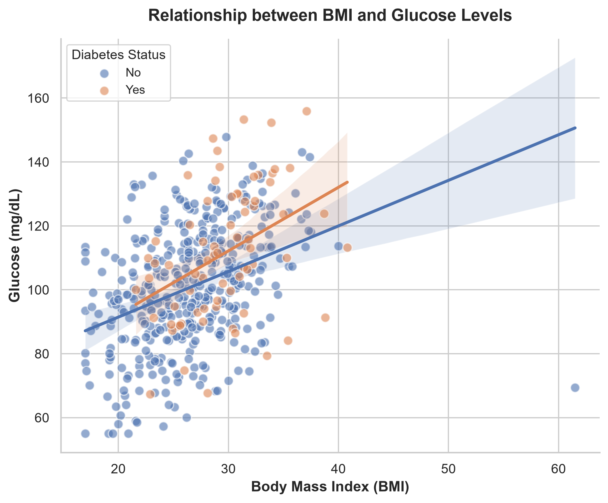
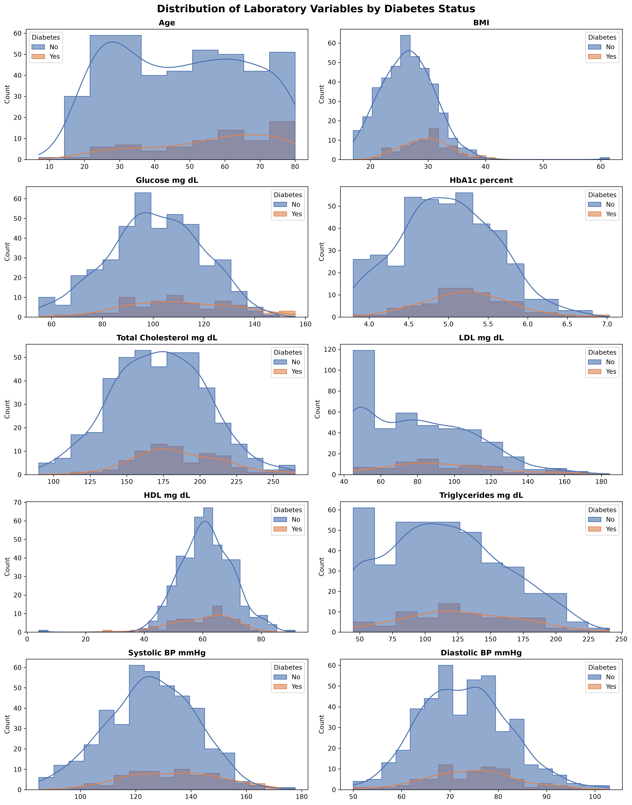
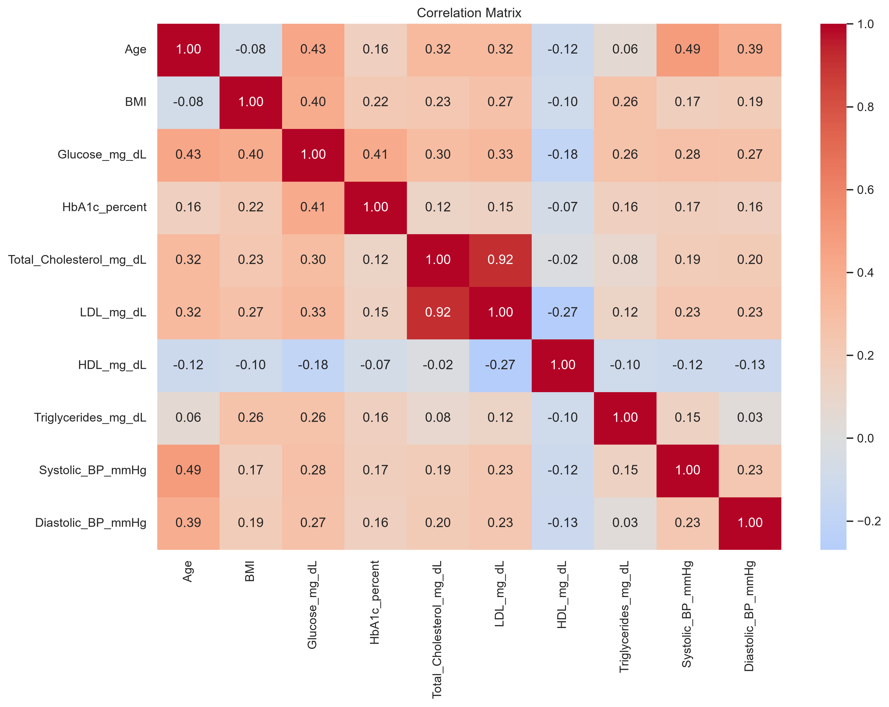

# 🏥 Laboratory Data Quality Assessment & Exploratory Analysis

*A portfolio project demonstrating end-to-end data cleaning and exploratory data analysis (EDA) on synthetic patient laboratory data.*




## 📋 Project Overview
A (fictional) private diagnostic laboratory wants to know whether a historical dataset of routine lab measurements is reliable enough for further statistical work. This project:

1. **Assesses and cleans** the data — missing values, duplicates, inconsistent categories, and physiologically implausible values.
2. **Summarizes** the main variables, overall and by sex / diabetes status.
3. **Explores relationships** between laboratory measurements with clear, publication-style charts.
4. **Reports** the results in a client-facing PDF report.

The full brief is in [PROJECT_BRIEF.md](PROJECT_BRIEF.md).

## 📁 Dataset
- **Source:** Synthetic patient-level laboratory records (`laboratory_patient_data_raw.xlsx`), generated for this portfolio project.
- **Size:** 503 records × 13 variables (500 after cleaning).
- **Variables:** `Age`, `Sex`, `BMI`, `Glucose`, `HbA1c`, `Total Cholesterol`, `LDL`, `HDL`, `Triglycerides`, `Systolic BP`, `Diastolic BP`, `Diabetes` (Yes/No).
- **Built-in data-quality issues:** missing values, inconsistent `Sex` labels, exact duplicates, and implausible values.

## 🛠️ Methodology
**Data quality & cleaning**
- Quantified missing values per variable (57 values across 6 variables, all < 2.5%) and kept them as missing rather than imputing.
- Standardized 5 `Sex` variants (`Male`, `Female`, `M`, `F`, `female`) into `Male` / `Female`; confirmed `Diabetes` only contains `Yes` / `No`.
- Removed 3 exact duplicate records (LAB-0058, LAB-0239, LAB-0412), keeping the first occurrence.
- Checked every variable against clinical reference ranges and **flagged** (not deleted) 7 implausible records in a new `Implausible_Flag` column (e.g. Age = 7, HDL = 4 mg/dL).
- Documented every decision in [`data_cleaning_log.csv`](data_cleaning_log.csv), generated by the notebook.

**Descriptive analysis**
- Summary statistics (mean, median, SD, quartiles) for all numeric variables.
- Counts and percentages for categorical variables.
- Comparison of laboratory variables between males and females and between diabetic and non-diabetic patients.

**Exploratory visualization**
- Histograms by diabetes status, boxplots by sex, scatter / regression plots, and a correlation heatmap.

## 📊 Key Findings
- **Total Cholesterol ↔ LDL** are very strongly correlated (r ≈ 0.92) → multicollinearity risk for future regression models.
- **BMI ↔ Glucose** show a moderate positive association (r ≈ 0.40), with a slightly steeper slope in diabetic patients.
- **Triglycerides ↔ HDL** are only very weakly related (r ≈ −0.10), and sex differences are small (median HDL is nearly identical in both sexes). These patterns are weaker than in real clinical populations — a limitation of the synthetic data that should be considered before further use.
- Diabetes prevalence is 14.8%; the cohort is balanced by sex (50.4% female).

| Distributions by diabetes status | Correlation heatmap |
|---|---|
|  |  |

## ⚠️ Assumptions & Limitations
- This is an **exploratory** analysis, not a clinical diagnostic tool; no causal claims are made.
- The data are synthetic, so findings are for demonstration only.
- Missing values were not imputed; if they are not Missing Completely at Random (MCAR), summary statistics may be slightly biased.
- Important clinical context (fasting status, medication, lifestyle) is not available.

## 💻 How to Reproduce
Requires Python 3.10+.

```bash
git clone <this-repository-url>
cd <repository-folder>
pip install -r requirements.txt
jupyter notebook Patients-data-analysis-notebook.ipynb
```

Then choose **Run → Run All Cells**. The notebook reads the raw Excel file from the project folder and regenerates the cleaned dataset, the cleaning log, and all charts in `charts/`.

## 📦 Project Structure
| File | Description |
|---|---|
| `Patients-data-analysis-notebook.ipynb` | Complete, reproducible Python workflow |
| `laboratory_patient_data_raw.xlsx` | Raw input data (never edited manually) |
| `laboratory_patient_data_cleaned.xlsx` | Cleaned dataset with `Implausible_Flag` column (generated) |
| `data_cleaning_log.csv` | Record of all data-quality decisions (generated) |
| `charts/` | All figures (generated) |
| `Exploratory-analysis_report.pdf` | Client-facing report (Word version: `.docx`) |
| `PROJECT_BRIEF.md` | Project brief and requirements |

## 🔧 Technologies
Python · Pandas · NumPy · Matplotlib · Seaborn · Jupyter Notebook · Excel

## 👤 Author
**Sepideh Ziaei Chamgordani** — PhD in Biophysics, Data Analyst (laboratory & biomedical data)
[LinkedIn](https://www.linkedin.com/in/sepideh-ziaei-chamgordani-862b711b7/)

## 📄 License
This project is licensed under the MIT License — see [LICENSE](LICENSE).
